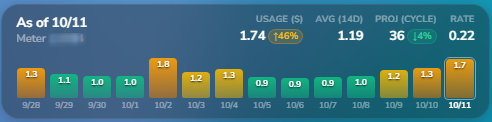

# PSE&G Energy (New Jersey) for Home Assistant

[](https://github.com/hacs/default)
[](https://opensource.org/licenses/MIT)

Home Assistant integration for Public Service Electric and Gas (PSE&G) customers in New Jersey. Retrieves daily electric meter readings, costs, and historical energy trends directly from the PSE&G MySmartEnergy portal (MyMeter).

Includes a built-in Lovelace card with 7-day and 14-day history views and kWh / cost switching.



## Features

- **Daily Smart Meter Readings**: Captures daily electricity usage (`sensor.pseg_electricity_consumption`).
- **Cost Tracking**: Tracks daily electricity costs in USD (`sensor.pseg_electricity_cost`).
- **Dynamic Rate Calculation**: Automatically calculates your effective electric rate from actual bill data.
- **Outdoor Temperature**: Records daily low, average, and high temperatures reported alongside meter readings (`sensor.pseg_outdoor_temperature`).
- **14-Day History**: Provides 14 days of interval usage and cost data in entity state attributes for local charting.
- **Manual Refresh**: Includes a refresh button (`button.pseg_refresh_data`) to trigger an immediate data fetch.
- **Built-in Lovelace Card**: Bundles `pseg-energy-card` ready to add from the card picker.

## Installation

### Via HACS (Recommended)

1. In Home Assistant, open **HACS** > **Integrations**.
2. Click the three dots in the top right and select **Custom repositories**.
3. Add the repository:
   ```text
   https://github.com/sidprax/ha-pseg
   ```
4. Set category to **Integration** and click **Add**.
5. Find **PSE&G Energy (New Jersey)**, click **Download**, and restart Home Assistant.

### Manual Installation

1. Copy the `custom_components/pseg` directory to your Home Assistant `config/custom_components/` folder.
2. Restart Home Assistant.

## Configuration

1. In Home Assistant, go to **Settings** > **Devices & Services** > **Add Integration**.
2. Search for **PSE&G Energy (New Jersey)**.
3. Choose your sign-in method:
   - **Automated Sign-In**: Enter your PSE&G portal username and password, then select your MFA delivery method (SMS or Email). When prompted, enter the 6-digit verification code.
   - **Session Cookie**: Alternatively, provide an active session cookie copied from `mysmartenergy.nj.pseg.com`.
4. Click **Submit**.

## Lovelace Card

The integration registers `pseg-energy-card` automatically. Add it to any dashboard:

```yaml
type: custom:pseg-energy-card
entity: sensor.pseg_electricity_consumption
```

### Options

| Option | Type | Default | Description |
|---|---|---|---|
| `entity` | string | `sensor.pseg_electricity_consumption` | Primary consumption entity |
| `toggle_entity` | string | `input_boolean.pseg_display_dollars` | Optional helper entity to switch between kWh and dollar view |
| `range_toggle_entity` | string | `input_boolean.pseg_chart_14d` | Optional helper entity to switch between 7-day and 14-day chart view |
| `show_next_update` | boolean | `false` | Display the next scheduled fetch timestamp beside the meter label |
| `popup_hash` | string | `null` | URL hash to open a custom popup card on tap. When omitted, tapping opens the standard entity dialog. |

## Entities Provided

- `sensor.pseg_electricity_consumption`: Latest daily electric usage in kWh (contains `history_14d` and daily stats)
- `sensor.pseg_electricity_cost`: Latest daily cost in USD
- `sensor.pseg_meter_id`: Meter serial number and service classification
- `sensor.pseg_latest_reading_date`: Date of the most recent recorded reading
- `sensor.pseg_outdoor_temperature`: Recorded low, average, and high temperatures
- `sensor.pseg_next_update`: Timestamp of the next scheduled polling attempt
- `button.pseg_refresh_data`: Button to trigger an immediate portal sync

## License

MIT
